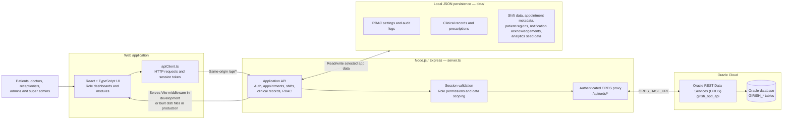

# Current System Architecture

The Express server is the app's backend-for-frontend: the browser calls it, and it checks sessions and permissions before serving local data or forwarding allowed requests to Oracle ORDS. Oracle is the primary store for core hospital records; selected RBAC, clinical, and supporting data are stored in local JSON files.
