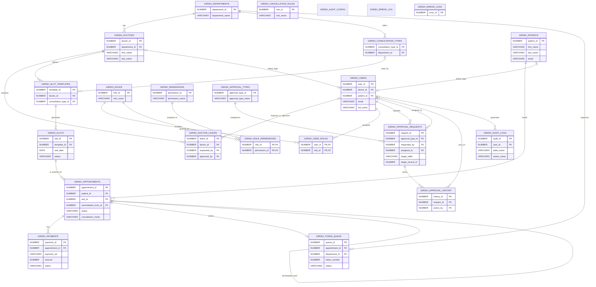

# Current Database ER Diagram

This is a **logical ER diagram** based on the current table inventory, API types, IDs, and joins used in the ORDS scripts. The repository contains handler scripts and migrations rather than the complete table-creation DDL, so confirm actual Oracle constraints before relying on these relationships for database changes.

`GIRISH_CANCELLATION_RULES`, `GIRISH_AUDIT_CONFIG`, and the two error-log tables are included because they exist in the current database table list; no direct relationship for them is shown where the application scripts do not establish one. Approval request `target_table` and `target_record_id` identify different kinds of records, so they are not modeled as a normal foreign key.
