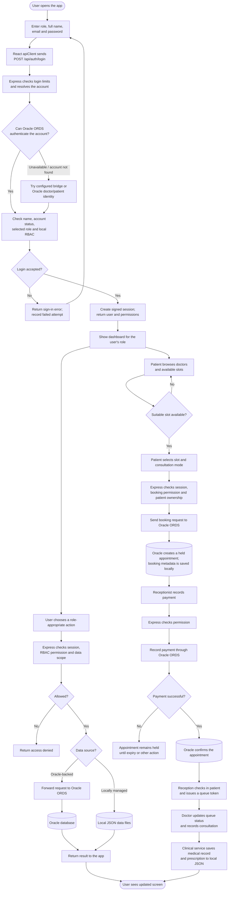

# Current User and Appointment Process

Appointment and payment requests go through the same authenticated and permission-checked backend path as other actions. The app records payments in its Oracle workflow; this diagram does not imply a separate external payment gateway.
